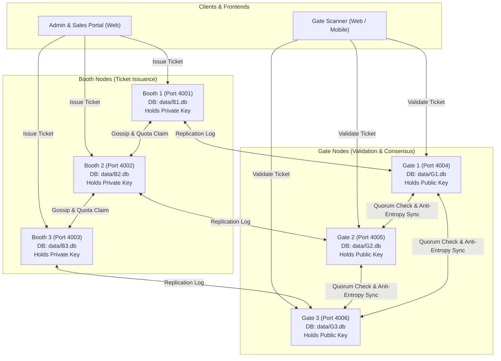

# FestPass Project Context & System Architecture

## 1. Project Goal

FestPass is a Distributed Campus Event Ticketing and Entry Validation system built for high-throughput, fault-tolerant university campus festivals.

Tickets are sold from multiple physical **BOOTH** nodes (`B1`, `B2`, `B3`) and validated at multiple physical **GATE** nodes (`G1`, `G2`, `G3`). The core technical mission of FestPass is solving the distributed double-spend and concurrent entry problem:

- Prevent overselling when booths operate semi-independently.
- Ensure a single ticket cannot be scanned at two entry gates simultaneously.
- Support **offline gate validation** during temporary campus Wi-Fi network dropouts.
- Provide deterministic **conflict resolution** when gates reconnect and synchronize their offline operations.
- Implement distributed systems fundamentals: state-machine replication, 64-bit unique ID generation, causal event ordering (Hybrid Logical Clocks), asymmetric cryptographic token verification (Ed25519), failure detection, and quorum consensus.

---

## 2. System Architecture

### 2.1 Topology & Role Distribution

The system runs 6 autonomous server processes on different ports, sharing the same codebase but retaining isolated SQLite database files in `data/<NODE_ID>.db`:

| Node ID | Role    | Port | Primary Responsibility                                                            |
| ------- | ------- | ---- | --------------------------------------------------------------------------------- |
| `B1`    | `booth` | 4001 | Sells tickets, holds Ed25519 private key, manages partitioned quota slice         |
| `B2`    | `booth` | 4002 | Sells tickets, holds Ed25519 private key, manages partitioned quota slice         |
| `B3`    | `booth` | 4003 | Sells tickets, holds Ed25519 private key, manages partitioned quota slice         |
| `G1`    | `gate`  | 4004 | Scans tickets, verifies Ed25519 signature offline, participates in quorum checkin |
| `G2`    | `gate`  | 4005 | Scans tickets, verifies Ed25519 signature offline, participates in quorum checkin |
| `G3`    | `gate`  | 4006 | Scans tickets, verifies Ed25519 signature offline, participates in quorum checkin |

### 2.2 Architecture Diagram



---

## 3. Tech Stack & Hard Rules

### 3.1 Strict Rules

1. **JavaScript Only**: Node.js 20+, CommonJS on the server (`type: "commonjs"`), React 18 (JSX) on the frontend. **NO TypeScript, NO Java, NO Python**.
2. **Monorepo Structure**: Uses standard `npm workspaces`: `packages/shared`, `apps/server`, `apps/web`.
3. **Storage Isolation**: One SQLite file per node (`data/<NODE_ID>.db`) to faithfully simulate independent machines.
4. **Local Execution**: All nodes run locally on separate ports without requiring Docker or cloud services.
5. **Quality Guarantee**: Every stage must leave the repository in a fully working state (`npm install`, linting, and all unit/integration tests must pass).

### 3.2 Stack Breakdown

- **Server**: Express 4, `better-sqlite3`, `zod`, `pino`, `pino-pretty`, `dotenv`, `cors`, `helmet`, `express-rate-limit`, `jsonwebtoken`, `bcryptjs`, `socket.io`, `undici`.
- **Testing**: `vitest` + `supertest`.
- **Frontend**: React 18, Vite, React Router, Tailwind CSS, Framer Motion, Axios, Zustand, React Hot Toast, `qrcode.react`, `html5-qrcode`, Recharts, Lucide React, Socket.IO Client.

---

## 4. Folder Structure & File Purpose

```
FestPass/
├── .env.example                               # Canonical template for environment variables
├── .gitignore                                 # Git ignore patterns (node_modules, data/, keys/, .env)
├── .prettierrc                                # Code formatting rules
├── eslint.config.js                           # Flat ESLint 9 configuration for CJS server & React JSX
├── package.json                               # Monorepo root package definition and cluster scripts
├── vitest.workspace.js                        # Multi-project test workspace config for Vitest
├── CONTEXT.md                                 # Quick entry banner and mandatory rule directive
├── README.md                                  # Setup and operational instructions
├── docs/
│   ├── API_CONTRACT.md                        # Complete API and wire protocol specifications
│   └── PROJECT_CONTEXT.md                     # Architecture, design decisions, and stage status
├── scripts/
│   ├── keygen.js                              # Ed25519 keypair generator script
│   └── seed.js                                # Database seed runner (Stage 2 implementation)
├── packages/
│   └── shared/                                # Common library shared across server and frontend
│       ├── package.json                       # Shared package manifest
│       ├── src/
│       │   ├── index.js                       # Barrel export for constants, snowflake, hlc, tokens, schemas
│       │   ├── constants.js                   # Enums for roles, statuses, errors, socket events
│       │   ├── snowflake.js                   # 64-bit BigInt Snowflake unique ID generator
│       │   ├── hlc.js                         # Hybrid Logical Clock with drift check and tie-breaking
│       │   ├── tokens.js                      # Ed25519 ticket signing and verification helpers
│       │   └── schemas.js                     # Zod validation schemas for all contract payloads
│       └── test/
│           ├── snowflake.test.js              # Unit tests for ID monotonicity and collision resistance
│           ├── hlc.test.js                    # Unit tests for causal ordering and drift rejection
│           └── tokens.test.js                 # Unit tests for Ed25519 signature validity and tampering
└── apps/
    ├── server/                                # Express server supporting booth and gate roles
    │   ├── package.json                       # Server manifest and dependencies
    │   ├── src/
    │   │   ├── server.js                      # Process entry point, HTTP listener, graceful shutdown
    │   │   ├── app.js                         # Express setup, middleware stack, route mounting
    │   │   ├── config/
    │   │   │   └── index.js                   # Zod-validated environment config loader
    │   │   ├── logger/
    │   │   │   └── index.js                   # Pino logger with node identity and pretty printing
    │   │   ├── db/
    │   │   │   ├── index.js                   # SQLite connection factory (WAL, foreign keys, busy timeout)
    │   │   │   ├── migrator.js                # Migration runner reading SQL migrations
    │   │   │   └── migrations/
    │   │   │       └── 001_initial_schema.sql # Relational tables with status support
    │   │   ├── middleware/
    │   │   │   ├── requestId.js               # Injects/propagates X-Request-Id and child logger
    │   │   │   ├── errorHandler.js            # Standardized JSON error response handler
    │   │   │   └── auth.js                    # JWT extraction and role-based access middleware (Stage 2)
    │   │   ├── routes/
    │   │   │   ├── health.js                  # /health and /node/info implementations
    │   │   │   ├── auth.js                    # Authentication routes (/auth/login, /auth/me)
    │   │   │   ├── events.js                  # Events CRUD with quota partitioning
    │   │   │   ├── tickets.js                 # Ticket issuance, bulk issue, and lookup
    │   │   │   ├── stats.js                   # Sales statistics endpoint (/stats/sales)
    │   │   │   ├── gate.js                    # Gate scanning and offline batch stubs (Stage 4)
    │   │   │   ├── cluster.js                 # Cluster status and conflict query stubs (Stage 3 & 4)
    │   │   │   └── internal.js                # Internal peer gossip, sync, quota borrow, and chaos
    │   │   ├── services/
    │   │   │   ├── idService.js               # Node-level Snowflake generator singleton
    │   │   │   ├── hlcService.js              # Node-level Hybrid Logical Clock singleton
    │   │   │   ├── tokenService.js            # Key loader and ticket signing/verification service
    │   │   │   ├── eventService.js            # Event management, partitioning, and op_log writer
    │   │   │   ├── ticketService.js           # Atomic quota sale, bulk issue, borrowing, and stats
    │   │   │   ├── gateService.js             # Gate validation logic service stub (Stage 4)
    │   │   │   └── replicationService.js      # Gossip and replication logic service stub (Stage 3)
    │   │   └── socket/
    │   │       └── index.js                   # Socket.IO initialization and broadcast helpers
    │   └── test/
    │       ├── health.test.js                 # Integration tests for health and metadata endpoints
    │       ├── db.test.js                     # Integration tests for SQLite schema and constraints
    │       ├── auth.test.js                   # Integration tests for auth and role middleware
    │       ├── events.test.js                 # Integration tests for events CRUD and partitioning
    │       ├── tickets.test.js                # Integration tests for ticket issuance, tokens, revocation
    │       ├── concurrency.test.js            # 200 concurrent requests oversell prevention test
    │       └── quota_borrow.test.js           # Quota borrowing and peer unreachable failure tests
    └── web/                                   # Frontend web application scaffold
        ├── package.json                       # Web manifest and frontend dependencies
        ├── vite.config.js                     # Vite build configuration
        ├── tailwind.config.js                 # Tailwind CSS configuration
        ├── postcss.config.js                  # PostCSS plugins (Tailwind, Autoprefixer)
        ├── index.html                         # SPA HTML entry point
        └── src/
            ├── index.css                      # Tailwind base and custom theme styling
            ├── main.jsx                       # React DOM mount point
            └── App.jsx                        # Stage 1 placeholder dashboard and architecture viewer
```

---

## 5. Environment Variables

| Variable              | Type         | Default        | Description                                                     |
| --------------------- | ------------ | -------------- | --------------------------------------------------------------- |
| `PORT`                | Number       | `4001`         | HTTP listening port (4001-4003 for booths, 4004-4006 for gates) |
| `NODE_ID`             | String       | `B1`           | Node identifier (`B1`..`B3`, `G1`..`G3`)                        |
| `NODE_ROLE`           | String       | `booth`        | Role: `booth`, `gate`, or `both`                                |
| `NODE_INDEX`          | Number       | Deduce from ID | 10-bit integer (1..6) for Snowflake ID uniqueness               |
| `DATA_DIR`            | String       | `./data`       | Directory where per-node SQLite databases are stored            |
| `JWT_SECRET`          | String       | Dev Secret     | Secret string used to sign and verify user JWTs                 |
| `LOG_LEVEL`           | String       | `info`         | Pino log level (`trace`, `debug`, `info`, `warn`, `error`)      |
| `ED25519_PRIVATE_KEY` | String (PEM) | Optional       | Private key for signing ticket tokens (Booth nodes)             |
| `ED25519_PUBLIC_KEY`  | String (PEM) | Required       | Public key for verifying ticket tokens (All nodes)              |
| `PEERS`               | String       | 6 nodes        | Comma-separated `NODE_ID=URL` cluster topology mappings         |

---

## 6. How to Run Everything

### 6.1 Installation & Key Generation

```bash
# 1. Install all dependencies across workspaces
npm install

# 2. Generate Ed25519 keypair and initialize .env
npm run keygen

# 3. Seed node databases with users and sample events
npm run seed
```

### 6.2 Running the Full 6-Node Cluster

```bash
# Starts B1, B2, B3, G1, G2, G3 concurrently with colorized logs
npm run cluster
```

### 6.3 Running Individual Nodes

```bash
npm run node:b1   # Starts Booth 1 on port 4001
npm run node:b2   # Starts Booth 2 on port 4002
npm run node:b3   # Starts Booth 3 on port 4003
npm run node:g1   # Starts Gate 1 on port 4004
npm run node:g2   # Starts Gate 2 on port 4005
npm run node:g3   # Starts Gate 3 on port 4006
```

### 6.4 Running Tests and Linting

```bash
npm run test         # Executes Vitest suite across packages and server
npm run lint         # Runs ESLint checks
npm run format:check # Verifies Prettier code formatting
npm run format       # Auto-formats all codebase files
```

### 6.5 Running Frontend Development Server

```bash
npm run dev -w apps/web  # Starts Vite frontend on http://localhost:3000
```

---

## 7. Data Model (SQLite Schema)

All tables are created in `apps/server/src/db/migrations/001_initial_schema.sql`:

1. `users`: System staff and administrators (`id`, `name`, `email`, `password_hash`, `role`, `created_at`).
2. `events`: Fest events (`id`, `name`, `venue`, `starts_at`, `capacity`, `price`, `status`, `created_at`).
3. `booth_quotas`: Partitioned quota allocations for booth oversell prevention (`event_id`, `node_id`, `quota`, `sold`). Primary key: `(event_id, node_id)`.
4. `tickets`: Issued tickets (`id`, `event_id`, `holder_name`, `holder_email`, `holder_phone`, `issued_by_node`, `issued_at_hlc`, `status`, `token`, `created_at`).
5. `checkins`: Entry attempts at gate nodes (`id`, `ticket_id`, `gate_node_id`, `hlc`, `mode`, `result`, `resolved`, `created_at`).
6. `op_log`: State-machine replication log for anti-entropy sync (`op_id`, `origin_node`, `hlc`, `type`, `payload_json`, `applied_at`).
7. `peers`: Gossip membership and heartbeat registry (`node_id`, `url`, `role`, `last_seen`, `status`).
8. `conflicts`: Logs of concurrent checkin attempts detected during sync (`id`, `ticket_id`, `winner_checkin_id`, `loser_checkin_id`, `detected_at`, `details_json`).
9. `meta`: Key-value configuration, idempotency records, and local replication watermark storage (`key`, `value`).

---

## 8. Core Distributed Systems Design Decisions

### 8.1 64-Bit Snowflake Unique IDs

- **Why**: Traditional auto-incrementing integer IDs require centralized coordination. Random UUIDv4 strings are 128-bit, lack index locality, and cannot be sorted chronologically.
- **Layout**: 1 bit sign (0) + 41 bits millisecond timestamp since epoch (~69 years) + 10 bits node index (up to 1,024 nodes) + 12 bits sequence (4,096 IDs per ms per node).
- **Failure Handling**:
  - **Clock Skew / Backward Drift**: If `timestamp < lastTimestamp`, small drift (≤ 1000ms) pauses and spins until clock catches up; large drift throws `ClockMovedBackwardsError`.
  - **Sequence Exhaustion**: If 4,096 IDs are generated within the exact same millisecond, the generator spins until the next physical millisecond.

### 8.2 Hybrid Logical Clock (HLC)

- **Why**: Physical clocks (`Date.now()`) on different machines suffer from NTP jitter and arbitrary backward corrections, making them unreliable for causal event ordering. Pure Lamport logical clocks lose connection to physical wall-clock time. HLC combines physical time bounds with logical monotonicity.
- **Ordering Guarantee**: Total ordering defined as:
  1. `wallTime` ascending
  2. `logical` counter ascending
  3. `nodeId` lexicographical tie-break (e.g. `'B1' < 'B2'`)
- **Offline Drift Protection**: Reject incoming messages if remote wall-time drifts more than `maxDriftMs` (default 60 seconds).

### 8.3 Asymmetric Ticket Tokens (Ed25519)

- **Why**: Gates must validate tickets during Wi-Fi outages without communicating with the central database or booths. Symmetric HMAC requires sharing the secret key with all gates, allowing a compromised gate to forge tickets.
- **Asymmetric Solution**:
  - **Booth Nodes** hold the Ed25519 **Private Key** and digitally sign `FP1.<ticketId>.<eventId>`.
  - **Gate Nodes** hold only the Ed25519 **Public Key**. Gate nodes can verify ticket authenticity and integrity 100% offline, but cannot mathematically forge or issue tickets.

---

## 9. Stage Ownership & Status

| Stage       | Focus Area                   | Primary Deliverables                                                  | Owner    | Status   |
| ----------- | ---------------------------- | --------------------------------------------------------------------- | -------- | -------- |
| **Stage 1** | Foundation & Core Primitives | Shared package, DB schema, config, HLC, Snowflake, Ed25519, contracts | Member 1 | **DONE** |
| **Stage 2** | Auth, Events & Booth Sales   | JWT auth, events CRUD, booth ticket sales, quota oversell prevention  | Member 2 | **DONE** |
| **Stage 3** | Replication & Membership     | Peer gossip, heartbeat failure detector, anti-entropy log sync        | Member 3 | **DONE** |
| **Stage 4** | Gate Validation & Quorum     | Offline validation, quorum checkin, concurrent double-scan resolution | Member 4 | PENDING  |
| **Stage 5** | Admin & Booth Frontend       | React admin dashboard, booth sales UI, ticket view with failover      | Member 5 | PENDING  |
| **Stage 6** | Scanner UI, Chaos & Testing  | Gate QR scanner, live cluster dashboard, chaos tools, load tests      | Member 6 | PENDING  |

---

## 10. Coding Conventions & Standards

- **File & Module Conventions**: CommonJS on the server (`require` / `module.exports`), ES Modules on the frontend.
- **Symbol Naming**:
  - Functions & variables: `camelCase`
  - Classes & components: `PascalCase`
  - Constants & Enums: `UPPER_SNAKE_CASE`
- **Error Formatting**: Always throw `AppError` or use the global error handler. All responses follow `{ success: false, error: { code, message, details } }`.
- **Logging**: Never use raw `console.log` in server code. Always use `req.log` or the node `logger` instance (`logger.info`, `logger.warn`, `logger.error`), which automatically binds `nodeId`, `role`, and `reqId`.

---

## 11. Git Workflow & Stage Boundaries

1. Every stage member creates a dedicated branch: `stage-<N>-<feature-name>` (e.g., `stage-2-sales`).
2. Make small, logical, conventional commits:
   - `feat: ...`
   - `fix: ...`
   - `chore: ...`
   - `docs: ...`
   - `test: ...`
3. **Stage Boundary Rule**: Do NOT modify files owned by another stage unless resolving a minimal, documented bug or integration blocker.
4. Before submitting PR to `main`:
   - `npm run test` must pass (all tests green).
   - `npm run lint` must pass (0 errors).
   - `npm run format:check` must pass.
   - Update `docs/PROJECT_CONTEXT.md` stage status.

---

## 12. Stage 1 Completion Report

### 12.1 Built in Stage 1

- **Monorepo Architecture**: Configured npm workspaces (`packages/shared`, `apps/server`, `apps/web`) with cross-platform npm scripts and Vitest test runner.
- **Shared Primitives (`@festpass/shared`)**:
  - `SnowflakeGenerator`: 64-bit BigInt unique ID generator with backward drift and sequence overflow handling.
  - `HLC`: Hybrid Logical Clock with monotonic logical increments, drift bounds, and total ordering tie-breaking.
  - `tokens`: Ed25519 key generation, ticket signing (`FP1.<ticketId>.<eventId>.<sig>`), and offline public key verification.
  - `constants` & `schemas`: Centralized enums and Zod validation schemas for all contract payloads.
  - 100% test coverage for all shared primitives (21 unit tests).
- **Server Foundation (`@festpass/server`)**:
  - Zod-validated environment config loader with role detection.
  - Pino structured logger with node context (`nodeId`, `role`).
  - SQLite database manager (`better-sqlite3` 12.11.1) with WAL mode, foreign keys, and migration runner.
  - Schema migration creating all 9 required relational tables (`users`, `events`, `booth_quotas`, `tickets`, `checkins`, `op_log`, `peers`, `conflicts`, `meta`).
  - Middleware stack: `requestId`, `errorHandler`, `auth` (stub).
  - Routes implemented: `GET /health` and `GET /node/info`.
  - Clearly marked route and service stubs (`// TODO(stage-2)`, `// TODO(stage-3)`, `// TODO(stage-4)`).
  - Socket.IO server initialization and event broadcast helpers.
- **Frontend Scaffold (`@festpass/web`)**:
  - React 18 + Vite + Tailwind CSS + Framer Motion.
  - Modern dark-mode architecture dashboard displaying cluster nodes, primitives, and 6-stage roadmap.
- **Scripts**:
  - `npm run keygen`: Generates Ed25519 keys, saves to `keys/`, and initializes `.env`.
  - `npm run cluster`: Concurrently runs all 6 nodes (`B1`..`G3`) on ports 4001..4006.
  - `npm run seed`: Stub script for Stage 2 database seeding.

---

## 13. Stage 2 Completion Report

### 13.1 Built in Stage 2

1. **Authentication & Role-Based Access Control**:
   - `POST /api/auth/login` and `POST /auth/login`: Authenticates users with `bcryptjs` password verification, rate-limited against brute force (30 attempts/min), returns signed JWT token.
   - `GET /api/auth/me` and `GET /auth/me`: Authenticated profile retrieval.
   - Shared JWT secret verification: Any node in the cluster (`B1`..`G3`) can verify tokens issued by any other node without network coordination.
   - Role enforcement middleware: `requireRoles('admin', 'booth_staff', 'gate_staff')`.
   - Node role enforcement middleware: `requireNodeRole('booth')` preventing gate nodes from issuing tickets (returning 403 `FORBIDDEN`).

2. **Database Seeding (`scripts/seed.js` / `npm run seed`)**:
   - Populates 1 administrator (`admin@campus.edu`), 2 booth staff (`booth1@campus.edu`, `booth2@campus.edu`), and 2 gate staff (`gate1@campus.edu`, `gate2@campus.edu`).
   - Seeds 3 sample campus events (`Annual TechFest 2026`, `Spring EDM Night 2026`, `Campus Hackathon Showcase`) across all 6 node SQLite databases in both `./data` and `./apps/server/data`.
   - Automatically partitions booth quotas across `B1`, `B2`, and `B3` and records `EVENT_UPSERT` in `op_log` with HLC timestamps.

3. **Event Management (CRUD & Quota Partitioning)**:
   - Full CRUD endpoints (`GET /events`, `POST /events`, `GET /events/:id`, `PUT /events/:id`, `DELETE /events/:id`) mounted at both `/api/events` and `/events`.
   - Admin-only access for mutations (`POST`, `PUT`, `DELETE`).
   - Search (`name`, `venue`), status filtering (`draft`, `on_sale`, `closed`, `active`), and pagination (`page`, `limit`, `totalPages`, `total`).
   - Single-point service write function (`eventService.upsertEvent`) that writes an `EVENT_UPSERT` entry into `op_log` with monotonic HLC timestamp and 64-bit Snowflake ID for downstream replication in Stage 3.
   - Deterministic quota splitting: divides event capacity evenly across booth nodes (`B1`, `B2`, `B3`) with remainder assigned to the primary node (e.g., 100 capacity -> B1: 34, B2: 33, B3: 33).

4. **Atomic Local Quota & Concurrency Oversell Prevention**:
   - In `ticketService.js`, sales decrement local booth quota atomically within a single SQLite transaction:
     ```sql
     UPDATE booth_quotas SET sold = sold + 1 WHERE event_id = ? AND node_id = ? AND sold < quota
     ```
   - Zero coordination required between booths to avoid overselling.
   - Rigorously verified under high concurrency: 200 concurrent sales requests against a quota slice of 40 yields exactly 40 successful sales (`201 Created`) and exactly 160 rejections (`409 OVER_QUOTA`), with zero oversold tickets.

5. **Inter-Booth Quota Borrowing Protocol**:
   - `POST /internal/quota/borrow` and `POST /internal/claim`:
     - **Receiver / Lender**: When requested by peer booth, atomically reduces local available quota in a transaction.
     - **Initiator / Borrower**: When running low on quota, requests quota slice from peer booth over HTTP. Increases local quota upon approval.
     - **Failure Handling**: If peer node is unreachable (network timeout / connection refused), returns `503 PEER_UNREACHABLE` with detailed diagnostic error message.

6. **Cryptographic Ticket Issuance & Lookup**:
   - `POST /api/tickets/issue` and `POST /tickets`:
     - Generates 64-bit Snowflake ticket ID.
     - Advances Hybrid Logical Clock (`hlcService.send()`).
     - Digitally signs ticket using node's Ed25519 private key (`FP1.<ticketId>.<eventId>.<sig>`).
     - Atomically writes ticket record to `tickets` table and `TICKET_ISSUED` operation to `op_log`.
     - Supports `Idempotency-Key` header: caches issued tickets in SQLite `meta` table, ensuring retried requests return the identical ticket without double-decrementing quota.
     - Emits `ticket:issued` Socket.IO event.
   - Bulk ticket issuance (`POST /tickets/bulk`): Atomically issues up to 20 tickets in a single transaction for group bookings. Rejects batches > 20 with `400 BAD_REQUEST`.
   - Query & Lookup: `GET /tickets/:id`, `GET /tickets?email=&phone=&eventId=`.
   - Revocation: `POST /tickets/:id/revoke` (admin only) updates ticket status to `revoked` and records `TICKET_REVOKED` in `op_log`.
   - Sales statistics: `GET /stats/sales` (and `/api/stats/sales`) providing revenue, ticket counts, and quota usage aggregated per event and per booth.

7. **Comprehensive Test Suite**:
   - 10 test suites, 56 unit/integration tests passing across `@festpass/shared` and `@festpass/server`:
     - `auth.test.js` (8 tests): login, bcrypt, token verification, RBAC, cross-node token verification.
     - `events.test.js` (6 tests): CRUD, quota partitioning, pagination, search, `EVENT_UPSERT` op_log.
     - `tickets.test.js` (9 tests): issue, Ed25519 signature validity, idempotency key caching, bulk issue, lookup, revocation, sales stats, gate node rejection.
     - `concurrency.test.js` (1 test): 200 concurrent requests without overselling.
     - `quota_borrow.test.js` (5 tests): quota lending, quota borrowing, peer unreachable handling, claim protocol.

### 13.2 Files Added and Modified in Stage 2

- **Modified Shared Package**:
  - `packages/shared/src/constants.js`: Added `OP_TYPES.EVENT_UPSERT`, `EVENT_STATUS.ON_SALE`, `EVENT_STATUS.CLOSED`.
  - `packages/shared/src/schemas.js`: Added `EVENT_STATUS.ON_SALE`, `EVENT_STATUS.CLOSED`, `bulkIssueTicketsSchema`, `borrowQuotaSchema`, and `OP_TYPES.EVENT_UPSERT` support.
- **Modified Schema**:
  - `apps/server/src/db/migrations/001_initial_schema.sql`: Added `'on_sale'`, `'closed'` to `events` table status check constraint.
- **Modified Server Core**:
  - `apps/server/src/app.js`: Dual route mounting under both `/api/*` and root `/*` (`/auth`, `/events`, `/tickets`, `/stats`, `/gate`, `/cluster`, `/internal`).
  - `apps/server/src/middleware/auth.js`: Added `authenticate`, `requireRoles`, and `requireNodeRole` middleware.
  - `apps/server/src/routes/auth.js`: Implemented login rate limiting, bcrypt verification, and `/me`.
  - `apps/server/src/routes/events.js`: Implemented events CRUD with admin guards and search/pagination.
  - `apps/server/src/routes/tickets.js`: Implemented ticket issuance, bulk issue, lookup, revocation.
  - `apps/server/src/routes/stats.js`: Added `/sales` sales statistics endpoint.
  - `apps/server/src/routes/internal.js`: Added `/quota/borrow` and `/claim` handlers.
- **New Services**:
  - `apps/server/src/services/eventService.js`: Event CRUD, quota partitioning, and `EVENT_UPSERT` op_log recording.
  - `apps/server/src/services/ticketService.js`: Atomic quota sales, bulk issuance, revocation, borrowing, and stats.
- **Scripts**:
  - `scripts/seed.js`: Complete seed script for all 6 nodes across `./data` and `./apps/server/data`.
- **New Tests**:
  - `apps/server/test/auth.test.js`
  - `apps/server/test/events.test.js`
  - `apps/server/test/tickets.test.js`
  - `apps/server/test/concurrency.test.js`
  - `apps/server/test/quota_borrow.test.js`

### 13.3 Environment Variables

No new environment variables required. Stage 2 fully utilizes existing configurations:

- `JWT_SECRET`: Used for symmetric signing and cross-node verification of user auth tokens.
- `ED25519_PRIVATE_KEY` / `ED25519_PUBLIC_KEY`: Used for asymmetric signing (booths) and verification (gates).
- `NODE_ROLE`: Enforces booth (`booth`, `both`) vs gate (`gate`) privileges.

### 13.4 How to Test (cURL Examples)

```bash
# 1. Login as Admin
curl -X POST http://localhost:4001/api/auth/login \
  -H "Content-Type: application/json" \
  -d '{"email":"admin@campus.edu","password":"AdminPass123!"}'

# Save token: export TOKEN="<token_from_login>"

# 2. Check current profile
curl http://localhost:4001/api/auth/me \
  -H "Authorization: Bearer $TOKEN"

# 3. Create Event (Admin only)
curl -X POST http://localhost:4001/api/events \
  -H "Authorization: Bearer $TOKEN" \
  -H "Content-Type: application/json" \
  -d '{
    "name": "Spring EDM Fest 2026",
    "venue": "Campus Arena",
    "startsAt": "2026-12-01T20:00:00.000Z",
    "capacity": 300,
    "price": 25.0,
    "status": "on_sale"
  }'

# 4. Issue Ticket on Booth B1 (Idempotent)
curl -X POST http://localhost:4001/api/tickets/issue \
  -H "Authorization: Bearer $TOKEN" \
  -H "Idempotency-Key: idem-sale-001" \
  -H "Content-Type: application/json" \
  -d '{
    "eventId": "evt_techfest_2026",
    "holderName": "Sarah Jenkins",
    "holderEmail": "sarah.j@campus.edu",
    "holderPhone": "+15550192834"
  }'

# 5. Bulk Issue Tickets (up to 20)
curl -X POST http://localhost:4001/api/tickets/bulk \
  -H "Authorization: Bearer $TOKEN" \
  -H "Content-Type: application/json" \
  -d '{
    "eventId": "evt_techfest_2026",
    "tickets": [
      {"holderName": "Student A", "holderEmail": "a@campus.edu", "holderPhone": "+15551111111"},
      {"holderName": "Student B", "holderEmail": "b@campus.edu", "holderPhone": "+15552222222"}
    ]
  }'

# 6. Borrow Quota from Peer Booth B2 to B1
curl -X POST http://localhost:4001/internal/quota/borrow \
  -H "Content-Type: application/json" \
  -d '{
    "eventId": "evt_techfest_2026",
    "targetNodeId": "B2",
    "amount": 25
  }'

# 7. View Sales Statistics
curl http://localhost:4001/stats/sales?eventId=evt_techfest_2026

# 8. Revoke Ticket
curl -X POST http://localhost:4001/api/tickets/<TICKET_ID>/revoke \
  -H "Authorization: Bearer $TOKEN" \
  -H "Content-Type: application/json" \
  -d '{"reason": "Student requested refund"}'
```

### 13.5 Known Limitations

- Inter-booth quota borrowing assumes peers have initialized their database schema (via `npm run seed` or on startup).
- Idempotency records are currently cached in the local SQLite `meta` table with key prefix `idempotency:`; cross-booth idempotency is resolved when operations replicate in Stage 3.

---

## 14. Handoff Notes for Stage 3 (Replication & Membership)

Stage 3 implements peer gossip heartbeats, failure detection, and anti-entropy state machine replication using the operation log (`op_log`). Stage 2 has prepared all necessary database rows and hooks:

### 14.1 Operation Log Records Emitted by Stage 2

Stage 3 should replicate rows from `op_log` where `applied_at` is newer than the receiving node's local watermark:

| Operation Type (`op_log.type`) | Emitted In         | Payload Schema (`payload_json`)                                                                                            | Replication Action on Target Node                                                                 |
| ------------------------------ | ------------------ | -------------------------------------------------------------------------------------------------------------------------- | ------------------------------------------------------------------------------------------------- |
| `EVENT_UPSERT`                 | `eventService.js`  | `{"event": {...}, "quotas": [...], "isUpdate": boolean}`                                                                   | Upsert event record into `events` table and update `booth_quotas` table.                          |
| `TICKET_ISSUED`                | `ticketService.js` | `{"ticketId": "...", "eventId": "...", "holderName": "...", "holderEmail": "...", "status": "valid", "token": "...", ...}` | Insert ticket into `tickets` table (especially on gate nodes so gates know valid tickets online). |
| `TICKET_REVOKED`               | `ticketService.js` | `{"ticketId": "...", "eventId": "...", "reason": "...", "revokedAtHlc": "..."}`                                            | Update ticket status to `'revoked'` in `tickets` table.                                           |

### 14.2 Replicating via HLC Ordering

- Every row in `op_log` contains a monotonic `hlc` timestamp string (`<wallTime>:<logical>:<nodeId>`).
- When synchronizing in `POST /internal/sync`, retrieve operations strictly after the caller's watermark using `HLC.compare(op.hlc, fromHlc) > 0`.
- Apply operations idempotently on target nodes (`INSERT OR IGNORE` or `ON CONFLICT DO UPDATE`).

### 14.3 Pre-wired Internal Routes for Stage 3

- `POST /internal/gossip`: Stub in `apps/server/src/routes/internal.js` receives peer heartbeats and synchronizes `hlcService.receive(remoteHlc)`. Ready for gossip algorithm.
- `POST /internal/sync`: Stub in `apps/server/src/routes/internal.js` ready to query `op_log` and stream log entries.

---

## 15. Stage 3 Completion Report

### 15.1 Built in Stage 3

1. **Peer Transport & Chaos Simulation Layer (`services/peerTransport.js`)**:
   - Universal outbound HTTP client for inter-node communication (`gossip`, `replicate`, `sync`, `borrow`, `claim`, and gate quorum).
   - In-memory chaos simulation (`global.__festpass_chaos` and `POST /internal/chaos`):
     - **Partitions**: Bidirectional and unidirectional traffic blocking throwing 503 (`NETWORK_PARTITION`).
     - **Artificial Latency**: Configurable delays before HTTP requests.
     - **Message Drops**: Percentage-based probabilistic outbound and inbound packet dropping.
     - **Reset**: Dynamic restoration of normal cluster networking.
   - Inbound chaos middleware mounted in `apps/server/src/routes/internal.js` protecting all `/internal/*` routes against partitioned or dropped incoming messages.

2. **Gossip Protocol & Failure Detection (`services/failureDetector.js`)**:
   - Background gossip sender (`POST /internal/gossip`) broadcasting local HLC, role, and known peer states every 3 seconds.
   - Failure state machine with states: `alive` (healthy), `suspect` (>6s without heartbeat), and `dead` (>15s without heartbeat).
   - Dynamic auto-recovery: any valid incoming traffic (`gossip`, `replicate`, `sync`) immediately restores a peer to `alive`.
   - Persisted status updates to SQLite `peers` table, and real-time Socket.IO broadcasts via `cluster:update`.

3. **CRDT Apply Engine (`services/crdtEngine.js`)**:
   - Deterministic convergent replication engine with strict HLC receive clock advancement.
   - Operation idempotency via `op_log.op_id` deduplication.
   - Conflict resolution rules:
     - `EVENT_UPSERT`: Last-Writer-Wins (LWW) by HLC timestamp with node ID tie-breaking.
     - `TICKET_ISSUED`: Add-only set (G-Set); preserves existing `revoked` tombstone state.
     - `TICKET_REVOKED`: Revocation wins over valid status.
     - `BOOTH_QUOTA_ADJUST`: Commutative delta-based counter updates across booth allocations.
     - `CHECKIN_RECORDED`: Documented extension hook for Stage 4 gate quorum resolution.

4. **Hybrid Push-Pull Replication Engine (`services/replicationService.js`)**:
   - **Eager Push Replication**:
     - Local writes trigger immediate background push (`POST /internal/replicate`) to all alive peers.
     - Automatic exponential backoff retry for transient network hiccups.
     - Dead or unreachable peers buffer operations into the SQLite `outbox` table (`002_stage3_replication.sql`).
   - **Pull Anti-Entropy Synchronization**:
     - Periodically (every 5 seconds) exchanges Version Vectors (`POST /internal/sync`).
     - Computes missing operations and applies batches in strict causal HLC order.
     - Outbox queue drainer automatically re-pushes buffered mutations when peers recover.

5. **Cluster Observability Endpoints (`routes/cluster.js`)**:
   - `GET /cluster/nodes`: Real-time state of all peers, URLs, roles, `last_seen`, `replicationLagOps`, and `replicationLagMs`.
   - `GET /cluster/replication`: Local node ID, version vector, outbox sizes per peer, total `op_log` count, and latest local HLC.
   - Socket.IO `cluster:update` broadcasts on heartbeat transitions and replication sync.

6. **Convergence Verification Script (`scripts/verify_convergence.js`)**:
   - `npm run verify:convergence`: Reads SQLite DB files across all 6 nodes (`B1`..`G3`), computes canonical MD5 hashes of `events` and `tickets`, and displays a formatted status table verifying cluster consistency.

7. **Documentation**:
   - `docs/REPLICATION.md`: In-depth architectural specification, ASCII/mermaid diagrams, protocol lifecycles, and CAP / HLC trade-off analysis.

### 15.2 Test Coverage

- 15 test suites, 77 unit & integration tests passing across `@festpass/shared` and `@festpass/server`:
  - `failure_detector.test.js` (4 tests): heartbeat gossip, suspect transitions, dead transitions, auto-recovery.
  - `crdt_engine.test.js` (6 tests): LWW event upserts, add-only ticket issuance, revocation priority, delta quota replication, HLC reception.
  - `convergence.test.js` (3 tests): 3-booth concurrent ticket issuance convergence, partition & heal catch-up, duplicate delivery idempotency.
  - `chaos.test.js` (4 tests): partition blocking, latency injection, message drops, chaos reset.
  - `cluster_observability.test.js` (4 tests): `/cluster/nodes`, `/cluster/replication`, replication lag metrics, Socket.IO broadcasts.

---

## 16. Handoff Notes for Stage 4 (Gate Validation & Quorum)

Stage 4 implements Gate Check-in Validation, Quorum Consensus, and Offline Scanning. Stage 3 provides the following interfaces, extension points, and transport mechanisms:

### 16.1 Exact CRDT Apply Hook for Checkins (`crdtEngine.js`)

In `apps/server/src/services/crdtEngine.js`, the method `applyCheckinOp(op, payload)` is the dedicated entry point for replicating checkin operations:

```javascript
// Located at apps/server/src/services/crdtEngine.js
applyCheckinOp(op, payload) {
  // EXTENSION POINT FOR STAGE 4:
  // Stage 4 should implement concurrent double-scan resolution here:
  // 1. Check if a checkin record for payload.ticketId already exists in checkins table.
  // 2. If concurrent checkins exist, apply HLC total ordering:
  //    - Winner: lowest HLC (first entry causally).
  //    - Loser: log to conflicts table with winner_checkin_id and loser_checkin_id.
  // 3. Update tickets.status = 'used' if valid entry.
}
```

### 16.2 Peer Transport API for Quorum Requests (`peerTransport.js`)

Stage 4 Gate nodes should communicate with peers using `peerTransport` to automatically benefit from connection timeouts, URL resolution, and chaos simulation:

```javascript
const peerTransport = require('../services/peerTransport');

// Making a POST request to peer B1 or G2
try {
  const response = await peerTransport.post(
    'G2',
    '/internal/gate/validate',
    {
      ticketId: '...',
      token: '...',
      hlc: hlcService.now(),
    },
    { timeoutMs: 2000 }
  );

  if (response.data.valid) {
    // Quorum vote collected
  }
} catch (err) {
  if (err.statusCode === 503) {
    // Peer is partitioned or unreachable
  }
}
```

Available helpers in `peerTransport`:

- `peerTransport.post(targetNodeId, endpoint, body, options)`
- `peerTransport.get(targetNodeId, endpoint, options)`
- `peerTransport.resolvePeerUrl(targetNodeId)`

### 16.3 Chaos Hook Usage for Gate Testing

Stage 4 integration tests can simulate offline gate scenarios and network partitions via `POST /internal/chaos` or direct programmatically via `peerTransport`:

```javascript
const peerTransport = require('../services/peerTransport');

// Isolate Gate 1 from all other nodes:
peerTransport.setRule({
  action: 'partition',
  blockedPeers: ['B1', 'B2', 'B3', 'G2', 'G3'],
});

// Or inject 1500ms 4G network delay:
peerTransport.setRule({
  action: 'delay',
  durationMs: 1500,
});

// Restore normal connectivity:
peerTransport.reset();
```
