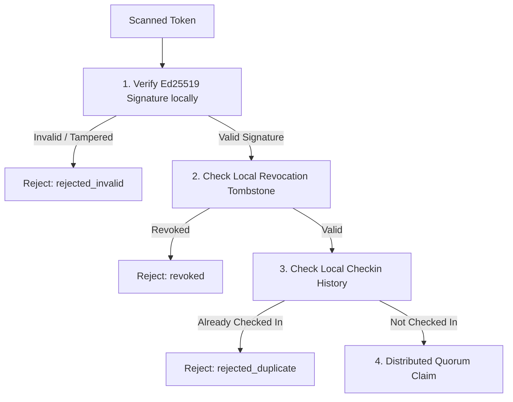
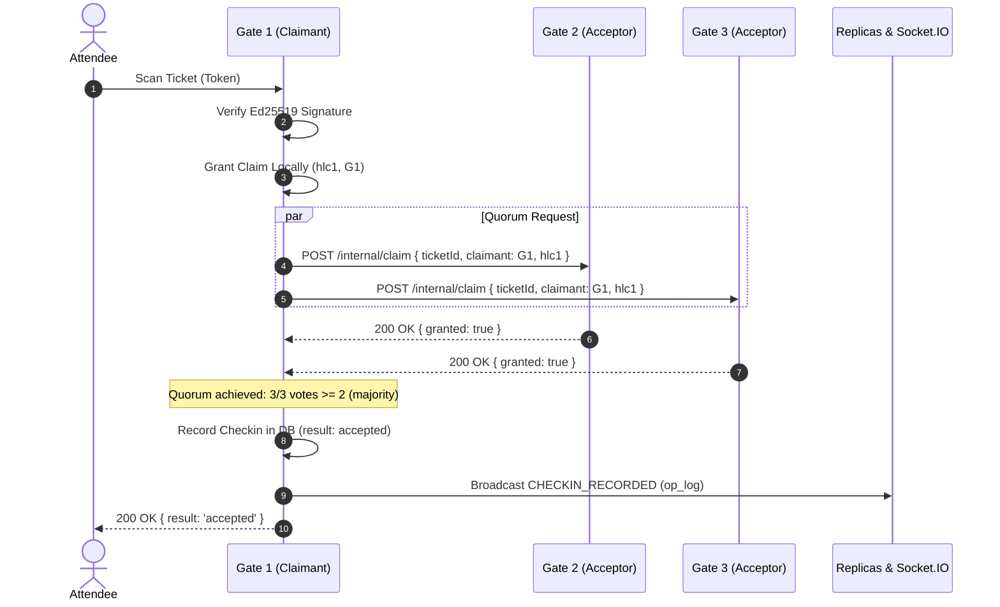
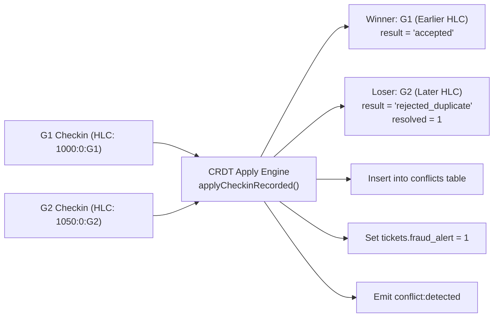

# FestPass Gate Validation & Quorum Consensus (Stage 4)

This document specifies the validation architecture, online quorum claim consensus protocol, offline signature verification, and CRDT conflict resolution engine implemented in Stage 4 of FestPass.

---

## 1. Overview & Objectives

In a distributed campus event environment, attendees arrive at physical gate check-in points (`G1`, `G2`, `G3`) simultaneously. Gate nodes must fulfill three critical distributed safety and availability guarantees:

1. **Zero Double-Spend Entry**: A single ticket cannot be accepted simultaneously at two separate gates.
2. **Offline Resilience**: When campus Wi-Fi drops or gates are partitioned, gate staff can continue validating attendees locally using cryptographic signatures without central database access.
3. **Deterministic Reconciliation**: When reconnected, all gate and booth replicas must converge on the exact same check-in winner, mark duplicates, and flag security/fraud alerts.

---

## 2. Token Architecture & Verification

Tickets issued by Booth nodes are digitally signed using **Ed25519 asymmetric cryptography**:

```
FP1.<ticketId>.<eventId>.<signatureBase64url>
```

- **Booth Nodes** hold the Ed25519 **Private Key** (used in `POST /tickets/issue`).
- **Gate Nodes** hold only the Ed25519 **Public Key** (`tokenService.verify(token)`).

### Verification Pipeline



---

## 3. Distributed Gate Quorum Claim Protocol

When an attendee scans a ticket at Gate $G_i$, $G_i$ initiates the **Distributed Quorum Claim Protocol** across all gate nodes ($G_1, G_2, G_3$):



### Acceptor Invariant & State Machine

Each gate node acts as an **Acceptor** that grants a claim for a given `ticket_id` to at most one claimant:

1. **State Persistence**: Grants are persisted in SQLite `ticket_claims` table (`ticket_id PRIMARY KEY, claimant_node_id, hlc, granted_at`). Process crashes do not erase granted claims.
2. **Causal Ordering**: If multiple claimants concurrently request a claim for the same ticket:
   - Lowest Hybrid Logical Clock $(HLC, nodeId)$ wins.
   - If incoming $HLC < existing.hlc$, the acceptor updates its grant to the new claimant (`granted = true`).
   - If incoming $HLC \ge existing.hlc$, the acceptor denies the grant (`granted = false`).
3. **Split Vote Backoff**: If split votes prevent achieving a majority ($\ge 2/3$), the claimant performs randomized exponential backoff (20–70ms) and retries up to 3 times with an updated HLC.

---

## 4. Offline Mode & Partition Policy

When campus network infrastructure fails, or a gate is partitioned from peers:

- The gate detects that peer gate nodes are unreachable (connection timeout or 503 network partition).
- The node evaluates `OFFLINE_POLICY`:
  - `allow_flagged` (Default): Validates Ed25519 signature offline, ensures ticket is not marked `used` or `revoked` in local replica, records check-in with `mode = 'offline'`, and marks `tickets.status = 'used'`.
  - `deny`: Strictly forbids gate entry without live quorum consensus.

### Offline Batch Sync (`POST /gate/scan-offline-batch`)

Mobile gate handheld devices that were offline can submit arrays of accumulated scans:

1. Replays scans strictly in causal HLC order.
2. Identifies any duplicate scans that occurred while disconnected.
3. Automatically triggers deterministic conflict resolution.

---

## 5. Conflict Resolution After Sync (CRDT Hook)

If a ticket was scanned at Gate 1 and Gate 2 while both were partitioned, two accepted check-in records will arrive during anti-entropy synchronization:



### Deterministic Invariant

- Total ordering via `HLC.compare(a.hlc, b.hlc)` guarantees that **every replica in the cluster independently reaches the identical verdict** without exchanging extra messages.
- The winning entry retains `result = 'accepted'`.
- The losing entry is updated to `result = 'rejected_duplicate'` with `resolved = 1`.
- A row is inserted into `conflicts` detailing the winner gate, loser gate, timestamps, and HLCs.
- `tickets.fraud_alert = 1` is flagged to alert event organizers of duplicate wristband reuse.

---

## 6. Safety vs. Liveness Trade-Offs (CAP Theorem)

| Mode                 | Consistency       | Availability                 | Partition Tolerance              | Latency | Distributed Guarantee                                               |
| :------------------- | :---------------- | :--------------------------- | :------------------------------- | :------ | :------------------------------------------------------------------ |
| **Online Quorum**    | CP (Linearizable) | Reduced during majority loss | Survives 1 gate failure out of 3 | 10–25ms | Guarantees zero double entries across all gates                     |
| **Offline Fallback** | AP (Eventual)     | 100% Available               | Survives total gate isolation    | 1–3ms   | Maximizes entrance throughput; resolves via HLC CRDT upon reconnect |
